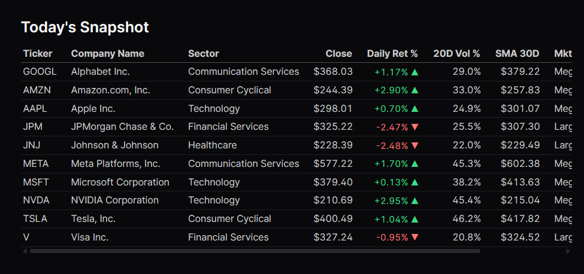

# Finance Analytics Pipeline

An ELT pipeline that pulls daily prices for ten US stocks from Yahoo Finance and six macroeconomic series from FRED, loads them into DuckDB or BigQuery, models them with dbt into a small star schema, and publishes an Evidence dashboard. One dashboard page is a market briefing written by Gemini, which is checked against the figures it was generated from before it is published.

Published dashboard: https://calemccammon.github.io/data-engineer-finance-analytics/



## Running it locally

Prerequisites: Python 3.13 or later, [uv](https://docs.astral.sh/uv/), a free [FRED API key](https://fred.stlouisfed.org/docs/api/api_key.html), and Node.js 18 or later for the dashboard. Yahoo Finance needs no key.

```bash
git clone https://github.com/calemccammon/data-engineer-finance-analytics.git
cd data-engineer-finance-analytics

uv sync                      # core dependencies and pytest
cp .env.example .env         # then set FRED_API_KEY in .env

(cd transform && uv run dbt deps)   # installs dbt_utils
```

Run all commands below from the repository root. The extract modules write Parquet files to `data/raw/` relative to the working directory. The DuckDB file is `data/processed/finance.duckdb`, or the path in `FINANCE_DB_PATH` if that is set.

### Pipeline CLI

```bash
uv run python main.py             # extract, load, then dbt run
uv run python main.py extract     # Yahoo Finance and FRED to data/raw/*.parquet
uv run python main.py load        # Parquet to the raw schema
uv run python main.py transform   # dbt run
```

`main.py transform` runs `dbt run` only. Seeds and tests are run through dbt directly or through Dagster.

### dbt

```bash
export FINANCE_DB_PATH="$PWD/data/processed/finance.duckdb"
cd transform
uv run dbt seed --profiles-dir .
uv run dbt run  --profiles-dir .
uv run dbt test --profiles-dir .
```

`FINANCE_DB_PATH` tells the dbt profile where the DuckDB file is. `main.py` and the Dagster assets set it themselves.

### Dagster

Dagster is in a separate dependency group.

```bash
uv sync --group orchestrate
uv run dagster dev -m orchestrate -p 3001    # UI at http://localhost:3001
```

### Dashboard

```bash
cd dashboard
npm ci
npm run sources    # runs the queries in sources/finance against the DuckDB file
npm run dev        # Evidence dev server, port 3000 by default
```

### Briefing

The briefing needs the `cloud` dependency group and a `GEMINI_API_KEY` in `.env`.

```bash
uv sync --group cloud
uv run python generate_briefing.py --dry-run   # print the prompt, the response and the check result
uv run python generate_briefing.py             # write dashboard/pages/briefing.md
uv run python generate_briefing.py --strict    # exit non-zero if the checks fail, write nothing
```

The committed `dashboard/pages/briefing.md` is a placeholder that this script overwrites.

### BigQuery

Setting `TARGET=bigquery` switches the loader, dbt and the briefing generator from DuckDB to BigQuery.

```bash
# .env
TARGET=bigquery
BQ_PROJECT=my-gcp-project
BQ_KEYFILE=/path/to/service-account.json
```

```bash
uv sync --group cloud
uv run python main.py
```

The loader creates a `raw` dataset in the `US` location and replaces its tables on each run. dbt writes to `finance_staging`, `finance_intermediate` and `finance_marts`. The dashboard's source queries are written against the DuckDB schema name `main_marts`. The deploy workflows rewrite that prefix to `finance_marts` with `sed` and replace `connection.yaml` before building against BigQuery.

## How it works

```
yfinance  ──▶ extract/stock_prices.py ─────────┐
FRED API  ──▶ extract/economic_indicators.py ──┴──▶ data/raw/*.parquet
                                                          │
                 load/loader.py (DuckDB)  or  load/bigquery_loader.py (BigQuery)
                                                          ▼
                 raw.raw_stock_prices   raw.raw_company_info   raw.raw_economic_indicators
                                                          │
                                                          ▼  dbt (transform/)
  staging        stg_stock_prices   stg_company_info   stg_economic_indicators
  intermediate   int_daily_returns  int_moving_averages  int_volatility  int_macro_context
  marts          fct_daily_trading  dim_company  dim_date
                                                          │
                         ┌────────────────────────────────┴───────────────┐
                         ▼                                                ▼
          dashboard/ (Evidence static site)          generate_briefing.py + briefing_checks.py
                                                     ──▶ dashboard/pages/briefing.md
```

### Sources

Yahoo Finance, through the `yfinance` library, provides about two years (730 calendar days) of daily OHLCV prices and company metadata for ten tickers: `AAPL`, `MSFT`, `GOOGL`, `AMZN`, `NVDA`, `TSLA`, `JPM`, `JNJ`, `V`, `META`. The list is `DEFAULT_TICKERS` in `extract/stock_prices.py`.

FRED provides five years of six series:

| Series | ID | Frequency |
|---|---|---|
| Federal Funds Rate | `FEDFUNDS` | Monthly |
| Consumer Price Index | `CPIAUCSL` | Monthly |
| Unemployment Rate | `UNRATE` | Monthly |
| 10-Year Treasury Yield | `DGS10` | Daily |
| Real GDP Growth Rate | `A191RL1Q225SBEA` | Quarterly |
| 10-Year Breakeven Inflation | `T10YIE` | Daily |

Each extract writes Parquet files to `data/raw/`. Each load replaces the raw tables (`CREATE OR REPLACE` in DuckDB, `WRITE_TRUNCATE` in BigQuery), so a rerun does not duplicate rows.

### dbt models

Staging models are views that rename and filter the raw tables. `stg_stock_prices` drops rows with a null date, a null close or a volume of zero or less and adds a surrogate key from ticker and date.

Intermediate models are views that hold the calculations:

| Metric | Model | Definition |
|---|---|---|
| Daily return % | `int_daily_returns` | (close − previous close) / previous close |
| Log return % | `int_daily_returns` | ln(close / previous close) |
| Overnight gap % | `int_daily_returns` | (open − previous close) / previous close |
| SMA 7 / 30 / 90 / 200 | `int_moving_averages` | Mean close over that many trading-day rows |
| Average volume 20 / 90 | `int_moving_averages` | Mean volume over that many rows |
| Relative volume | `int_moving_averages` | Volume divided by the mean of the previous 20 rows |
| 52-week high / low | `int_moving_averages` | Max and min close over 252 rows |
| Price position (52w) | `int_moving_averages` | 0 at the 52-week low, 1 at the high |
| Realized volatility 20 / 60 | `int_volatility` | Standard deviation of log returns × √252 |
| Macro columns | `int_macro_context` | FRED series pivoted wide and forward-filled to each trading date |
| Real yield 10y | `int_macro_context` | 10-year Treasury yield minus 10-year breakeven inflation |

FRED series arrive at daily, monthly and quarterly frequency. `int_macro_context` carries the last published value forward with `last_value(... ignore nulls)`, so every trading date has a value for every series. A monthly rate published on the first of the month is treated as still in force on the fifteenth.

Marts are tables:

```
                    ┌──────────────────┐
                    │   dim_date       │
                    │──────────────────│
                    │ calendar_date PK │
                    │ year             │
                    │ month_name       │
                    │ quarter_num      │
                    │ is_trading_day   │
                    │ fiscal_quarter.. │
                    └────────┬─────────┘
                             │
┌──────────────┐    ┌────────▼─────────────────────────────┐
│ dim_company  │    │         fct_daily_trading             │
│──────────────│    │───────────────────────────────────────│
│ company_key  │    │ price_id          PK                  │
│ ticker       ◄────┤ ticker            FK → dim_company    │
│ company_name │    │ trading_date      FK → dim_date       │
│ sector       │    │ open_price                            │
│ industry     │    │ close_price                           │
│ market_cap   │    │ prev_close_price                      │
│ market_cap.. │    │ daily_return_pct                      │
│ exchange     │    │ log_return_pct                        │
│ country      │    │ sma_7d / 30d / 90d / 200d             │
└──────────────┘    │ volume / avg_volume_20d               │
                    │ volatility_20d_annualized             │
                    │ high_52w / low_52w                    │
                    │ price_position_52w                    │
                    └───────────────────────────────────────┘
```

`fct_daily_trading` has one row per ticker per trading day. It also carries the forward-filled macro columns and a denormalised `company_name`, `sector` and `industry`, which is what the dashboard queries read. The foreign keys are checked by dbt tests and are not database constraints. `dim_date` is a fixed calendar generated by `dbt_utils.date_spine` from 2020-01-01 up to 2028-01-01, with an `is_trading_day` flag set from the price data. It contains adapter-specific branches because DuckDB and BigQuery disagree on day-of-week numbering and date formatting functions.

### Dagster

`orchestrate/` defines nine assets in a single chain:

```
raw_stock_prices ────────┐
raw_company_info ────────┼─▶ raw_tables ─▶ dbt_seeds ─▶ dbt_staging ─▶ dbt_intermediate ─▶ dbt_marts ─▶ dbt_tests
raw_economic_indicators ─┘
```

Each dbt asset runs one layer through dbt's Python API (`dbtRunner`) and attaches the dbt output to the materialization as metadata. There are three jobs: `full_pipeline`, `ingest_only` (extract and load) and `transform_only` (the dbt assets).

| Schedule | Cron (UTC) | Job |
|---|---|---|
| `daily_pipeline_schedule` | `0 23 * * 1-5` (23:00, Monday to Friday) | `full_pipeline` |
| `weekly_transform_schedule` | `0 8 * * 6` (08:00, Saturday) | `transform_only` |

The schedules run only while a Dagster instance is running and after they have been switched on in the UI. The published dashboard is refreshed by GitHub Actions, not by Dagster.

### Dashboard

`dashboard/` is an [Evidence](https://evidence.dev) project: Markdown pages with embedded SQL, built to a static site. The queries in `dashboard/sources/finance/` read `fct_daily_trading`.

| Page | Contents |
|---|---|
| `/` | Daily summary tiles, 52-week return by ticker, latest snapshot table, sector table |
| `/briefing` | The generated market briefing |
| `/stocks` | Per-ticker price with 30-day and 200-day SMA, volume, daily and monthly returns, volatility |
| `/macro` | Rates, unemployment, CPI, returns grouped by Fed Funds rate band, yield against volatility |

### GitHub Actions

| Workflow | Trigger | Steps |
|---|---|---|
| `ci.yml`, job "Unit Tests & dbt Compile" | Push or pull request to `main` | `pytest tests/`, then `dbt deps` and `dbt compile` |
| `ci.yml`, job "Full Pipeline + dbt Tests" | Push to `main` | Extract, load into DuckDB, `dbt seed`, `dbt run`, `dbt test` |
| `deploy-dashboard.yml` | Push to `main`, or manual | Generate the briefing from BigQuery, build Evidence against BigQuery, deploy to GitHub Pages, run Playwright against the deployed URL |
| `refresh-and-deploy.yml` | Manual | Extract, load to BigQuery, `dbt seed`, `run` and `test` on BigQuery, then the same briefing, build, deploy and Playwright steps |

The full-pipeline job is skipped on pull requests so that they do not call the FRED API. The workflows read four repository secrets:

| Secret | Value |
|---|---|
| `FRED_API_KEY` | FRED API key |
| `BQ_PROJECT` | GCP project ID |
| `GOOGLE_CREDENTIALS` | Contents of a service account JSON key with BigQuery Data Editor and BigQuery Job User roles |
| `GEMINI_API_KEY` | Google AI Studio API key |

GitHub Pages must be set to deploy from GitHub Actions.

## The briefing and its checks

`generate_briefing.py` queries the latest trading day from `fct_daily_trading`, builds a prompt containing each ticker's close, daily return, 20-day volatility and 52-week position, the sector averages, six macro values and the 52-week best and worst performers, and sends it to `gemini-2.5-flash`.

The response is then checked by `briefing_checks.py` against the same metrics dict the prompt was built from. Because the inputs are already in memory, the check needs no second model call and no labelled data. It is four deterministic functions over the generated text:

| Check | Rule |
|---|---|
| Numeric grounding | Every number in the text must equal some value the prompt contained, at the precision it is written. "2.1%" is accepted for a source value of 2.145. |
| Attribution | In a sentence that names exactly one ticker and no other tracked company, a number must be one of that ticker's own values or a market-wide value (sector, macro, counts). Another ticker's close or return is rejected. |
| Superlatives | A sentence that contains a phrase such as "top gainer" or "worst performer" and names a ticker must name the ticker that is the actual extreme, by daily return or by 52-week return. |
| Direction | A sentence that names exactly one ticker and uses only rising words or only falling words must agree with the sign of that ticker's daily return. |

The set of accepted values is built from the columns the prompt shows, not from every column queried, so a figure counts as grounded only if the model could have read it. The set also includes absolute values (so "fell 1.23%" matches −1.23), the counts of tickers, gainers, losers and sectors, and the difference between each pair of macro rates in points and in basis points. No other derived figure is accepted. Dates, list numbering and labels such as "52-week" or "10-year" are stripped before numbers are extracted.

An empty response fails. If any check fails, the prompt is sent once more with the violations listed. There is one retry and no loop: each attempt costs a call, and a second failure after the specific figures were named is unlikely to be fixed by a third. If the retry also fails, the script writes a briefing rendered directly from the metrics, with a warning banner saying the model's version was withheld. With `--strict` it exits non-zero and writes nothing. The deploy workflows do not pass `--strict`.

### What the checks do not catch

- A number is tied to a ticker only in sentences that name a single ticker. In a sentence with two or more tickers, or one that names another company without its ticker, a correct figure attached to the wrong company passes.
- A number is never tied to a metric. A ticker's volatility described as its return passes.
- A whole number is accepted if any source value lies within 0.5 of it. Integers from 1900 to 2100 are treated as years and skipped.
- The superlative check passes when the correct ticker appears anywhere in the sentence. It does not look at company names without a ticker, at sectors, or at superlatives about anything other than return.
- The direction check skips sentences with two or more tickers and sentences that mix rising and falling words. It always compares against the daily return, including in sentences about the 52-week period. Statements about the direction of rates or other macro series are not checked, and the data holds only one day of macro values to check them against.
- A claim made without digits ("sentiment is deteriorating") is not checked, and neither is any interpretation or forecast. A response that contains text but no figures passes.
- The checks also reject some true statements: a derived figure other than a rate spread, a numeric range written with a hyphen, or a label that is missing from `_LABEL_PATTERNS` (for example "52 weeks").

The checks establish that the figures in the briefing came from the data. They say nothing about whether the analysis is sound.

## Testing

`pytest tests/` runs 48 tests with no network access or credentials:

- `tests/test_briefing_checks.py` (37) covers fact collection, number extraction, each of the four checks, the empty response, and that the fallback briefing passes its own checks.
- `tests/test_loading.py` (9) loads small Parquet fixtures into a temporary DuckDB file and checks tables, row counts, that a second load does not duplicate rows, and that `FINANCE_DB_PATH` is used.
- `tests/test_extraction.py` (2) checks the default ticker list.

The extract modules, the BigQuery loader and the generate, retry and fallback flow in `generate_briefing.py` have no unit tests. They are exercised by the CI pipeline job and the deploy workflows.

`dbt test` runs 55 tests: 47 `unique` and `not_null` tests declared in the model, source and seed YAML files, and 8 SQL tests in `transform/tests/`:

| Test | Fails when |
|---|---|
| `assert_valid_ohlc` | Any OHLC price is ≤ 0, high is below open, close or low, or low is above open or close |
| `assert_positive_volume` | A raw price row has volume ≤ 0 |
| `assert_reasonable_daily_return` | A daily return exceeds ±75% |
| `assert_reasonable_volatility` | 20-day annualized volatility is below 0.1% or above 500% |
| `assert_no_large_date_gaps` | Consecutive trading dates for a ticker are more than 7 calendar days apart |
| `assert_sufficient_history` | A ticker has fewer than 200 trading days |
| `assert_fct_tickers_in_dim_company` | A fact row's ticker has no company row |
| `assert_fct_dates_in_dim_date` | A fact row's date is missing from `dim_date` |

`assert_positive_volume` reads the raw table because the staging model filters those rows out.

`dashboard/tests/dashboard.spec.js` holds 11 Playwright smoke tests that check each page renders its headings, metric tiles and at least one table cell. They assert on headings and not on chart contents, because the charts do not reliably render in headless Chrome. The deploy workflows run them against the published site after each deployment.

## Limitations

- BigQuery is refreshed only when the "Refresh Data & Deploy Dashboard" workflow is triggered by hand. A push to `main` rebuilds the dashboard and regenerates the briefing from whatever data is already there. The as-of date is shown at the top of the overview page and in the briefing banner.
- Source freshness thresholds are declared in `transform/models/staging/_staging.yml` (warn at 25 hours and error at 49 hours for prices and company data, 40 and 60 days for FRED), but no workflow, job or script runs `dbt source freshness`.
- The `data_type` entries on the source tables are documentation. Nothing enforces them.
- Rolling windows have no minimum row count. The first 199 rows of `sma_200d` for a ticker are averages over fewer than 200 days, and the same applies to the other windows.
- A ticker or FRED series that fails to download is logged and skipped. The run continues with the rest.
- The `sp500_companies` seed is loaded and tested but not referenced by any model.
- `yfinance` is an unofficial client for Yahoo Finance and can break when Yahoo changes its site.

## Data attribution

Price and company data come from Yahoo Finance through [yfinance](https://github.com/ranaroussi/yfinance). Macroeconomic series come from FRED, Federal Reserve Bank of St. Louis.
